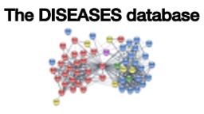

## Learning objectives

In these exercises, we will use a variety of text-mining tools and databases based on text mining to interpret the associations of genes and diseases. The exercises will teach you how to:

* automatically recognize named entities in text and compare dictionary-based and deep learning-based tools
* use named entity recognition for synonym-aware information retrieval
* extract associations based on cooccurrence of entities in the literature
* critically evaluate the output of large language models against text-mining evidence

## Prerequisites

All exercises are purely web-based and work in any modern browser. For Exercise 2.3 you need access to an LLM chatbot (e.g. ChatGPT, Claude, Gemini or Microsoft Copilot).

## Exercise 1

In this exercise we will first introduce the basics of text mining: 1) dictionary-based __named entity recognition__ and 2) how this can be used to help __retrieve literature__. Afterwards we will move on to how one can use the complete literature to 3) __extract associations between entities__ and finally 4) how these associations can be used for __knowledge discovery__.

### 1.1 Named Entity Recognition

The goal of named entity recognition (NER) is to find names mentioned in text and resolve them to the underlying biomedical entities (document → entity A, entity B, entity C). To illustrate this, we will compare two tools: [PubTator 3](https://www.ncbi.nlm.nih.gov/research/pubtator3/), which uses deep learning, and [OnTheFly2.0](https://pavlopoulos-lab-services.org/shiny/app/onthefly), which uses the same dictionary-based tagger as the JensenLab resources used in the rest of these exercises.

We will look at the paper "Identification of BCL-XL as highly active survival factor and promising therapeutic target in colorectal cancer" ([Scherr et al., 2020](https://www.ncbi.nlm.nih.gov/pmc/articles/PMC7568722/)).

Go to [PubTator 3](https://www.ncbi.nlm.nih.gov/research/pubtator3/) and search for **PMID 33070156**. The recognized entities are highlighted in the abstract, and the panel on the left lists them by type.

_1. What do the different colors mean? How many different types of biomedical entities can you see in the abstract? Does any term seem to be put in a wrong category?_

Click on **BCL-XL** to see which entity it has been linked to.

_2. Is there a difference between BCL-XL and BCL2L1?_

Now copy the abstract (as one paragraph, without line breaks) and paste it into [OnTheFly2.0](https://pavlopoulos-lab-services.org/shiny/app/onthefly). Select **Homo sapiens** as the organism for protein annotation and click **Annotate**. Open the **Entities** tab to see the list of recognized entities with their identifiers.

_3. What is the Ensembl Protein ID of BCL-XL and what is the Disease Ontology identifier of colorectal cancer in OnTheFly? Which identifiers does PubTator use for the same two entities? Why does it matter that different tools use different identifiers?_

_4. Compare the two annotations. Are there entities that one tool finds and the other misses? Does any annotation look wrong given the context? Which errors are typical of a dictionary-based approach, and which of a deep learning-based one?_

_5. **Optional exercise**: During the lecture, we discussed precision and recall. Suppose you have the following results from two systems for gene NER on the same test corpus:_

* **System A: Precision = 92%, Recall = 61%**
* **System B: Precision = 78%, Recall = 80%**
  
_Compute the F1-score for both systems. Which would you prefer in a curation context, and which in a discovery context? Why?_

_Hint: F1 = 2×(precision×recall)/(precision+recall)_

### 1.2 Information retrieval

The goal of information retrieval (IR) is to find the documents pertaining to a topic of interest. When the topic is a biological entity (A), NER can be used to index the literature and thereby support retrieval of relevant documents (A → documents).

We run the same dictionary-based NER system used in OnTheFly on the entire PubMed every week and make the results available through a suite of web resources. One such resource is [DISEASES](https://diseases.jensenlab.org/). While primarily intended to view disease–gene associations extracted from literature, it can also be used for information retrieval.

Click the following link to retrieve abstracts that mention the gene **SCN2A**:

<https://diseases.jensenlab.org/Entity?documents=10&type1=9606&id1=ENSP00000490107>

_6. Do the abstracts shown in the first two pages all highlight SCN2A or are there other words highlighted? If the latter is true, can you think of a reason why?_

You can similarly use NER to retrieve abstracts for any disease in the Disease Ontology. For example, the following query will retrieve abstracts for **neurodegenerative disease** (DOID:1289):

<https://diseases.jensenlab.org/Entity?documents=10&type1=-26&id1=DOID:1289>

_7. Which diseases are highlighted in the abstracts? Can you think of the reason why other diseases are also mentioned?_

_8. **Optional exercise**: We want to measure the similarity between the following sentences:_

* _Sentence A: TP53 is mutated in many cancer patients._
* _Sentence B: A BRCA1 mutation is associated with breast cancer in women._
* _Sentence C: Insulin signaling is important in diabetes._

Can you calculate the Term Frequency (TF), i.e. how many times each word appears in each document, the Inverse Document Frequency (IDF), i.e. the log(total number of documents / number of documents containing the word), the TF-IDF score (multiply TF×IDF) and the cosine similarity of the documents, i.e. dot(A,B)/ (\|\|A\|\| × \|\|B\|\|)? Which pair of sentences is most similar? Does this make sense given their content?

Reminder: For TF–IDF vectors, the dot product is the sum over the entire vocabulary, i.e. dot(A, B) = ∑w tfidfA(w) × tfidfB(w)
where w = word in documents, which only contributes for words where both TF–IDF values are nonzero. So, the dot product equals 0 if there are no shared nonzero-IDF words between two sentences.

_Hint: You will not need to calculate all the cosine similarities to answer this exercise._

_**Optional follow-up**: Now add:_

* _Sentence D: Hyperglycaemia during gestation._

_Without recomputing the whole table, what is the TF–IDF cosine similarity between C and D? Would you expect a modern embedding model (as used in semantic search) to give the same similarity of 0? Why or why not?_

### 1.3 Relation extraction

The goal of cooccurrence-based relation extraction (RE) is to link entities (A, B) to each other based on them being mentioned together in documents (A → documents → B).

Go to <https://diseases.jensenlab.org/> and query for **LRRK**. You are now presented with two options, since there are two gene names starting with LRRK, namely LRRK1 and LRRK2. Click on the **LRRK2** row to view the disease associations for this gene.

_9. Which disease is most strongly associated with LRRK2 according to text mining?_

Click on **Parkinson's disease** in the text-mining table.

_10. Do the abstracts in fact support an association between Parkinson's disease and LRRK2?_

Now click on **Alzheimer's disease**.

_11. Do the abstracts support an association in this case too? If not can you think of reasons why this association has such a high score?_

Cooccurrence-based relation extraction is a very generic approach, which can be used to find associations between any two types of entities for which we can do NER. For example, we can use the same approach to extract **human phenotypes** associated with **SCN1B** from the mammalian phenotypes database:

<https://phenotypes.jensenlab.org/Entity?textmining=20&type1=9606&type2=-36&id1=ENSP00000396915>

Click on **Seizures** and look at the associations between that term and **SCN1B**.

_12. Is this association supported by only few papers or is it well established in the literature? Do all the papers that mention the two terms actually support this association?_

_Note: You do not need to provide the actual number of papers supporting the association._

## Exercise 2
In this exercise, we will focus on how one can utilize the text-mining tools used in Exercise 1 to analyze an observed association between **epilepsy** and **autism spectrum disorders**.

### 2.1 Using NER to dig deeper

The **SCN2A** gene is well known to be involved in **epilepsy**. To check if it has also been implicated in **autism spectrum disorders**, we will perform a systematic search for literature linking the two. A simple PubMed search retrieves only 25 publications:

<https://www.ncbi.nlm.nih.gov/pubmed/?term=%22SCN2A%22+%22autism+spectrum+disorders%22>

Since **SCN2A** (ENSP00000490107) and **autism spectrum disorder** (DOID:0060041) are both named entities in our dictionary, we can instead use the results of NER to retrieve relevant documents:

<https://diseases.jensenlab.org/Entity?documents=50&type1=9606&type2=-26&id1=ENSP00000490107&id2=DOID:0060041>

The NER-based approach retrieves many more publications. Inspect some of these abstracts.

_13. Are they relevant and why were they not found by the initial search in PubMed?_

### 2.2 Linking diseases via genes

Above, we saw how existing text-mining resources can be used to retrieve abstracts connecting entities of interest and to extract associations. We will now use this in a different way to attempt to find genes that link two diseases of interest.

The first idea is to use NER-based information retrieval to find abstracts that mention both **epilepsy** (DOID:1826) and **autism spectrum disorder** (DOID:0060041). Click the link below to view these abstracts:

<https://diseases.jensenlab.org/Entity?documents=10&type1=-26&&type2=-26&id1=DOID:1826&id2=DOID:0060041>

_14. Which, if any, genes do you see mentioned in abstracts in the first two pages?_

_Note: The genes will not be highlighted with any color this time._

This approach obviously only works when the association between the two diseases is sufficiently well described in the literature for there to be abstracts that mention both diseases as well as the genes of interest. If that is not the case, but one has a candidate gene in mind, one can instead use information extraction to obtain a list of diseases for the gene in question to see if it is in fact associated with both diseases in the literature. Go to <https://diseases.jensenlab.org/>, query for **SCN2A**, and view the disease associations obtained from text mining.

_15. Is SCN2A associated with both diseases of interest?_

When one does not have a candidate gene, the best solution is to obtain two gene lists, one for each disease, and then identify the ones that rank high on both lists. This is a variant of the closed knowledge discovery problem. It is unfortunately not currently possible to perform such an analysis via a web interface, but it can be done by downloading the complete set disease–gene association from the [DISEASES downloads page](https://diseases.jensenlab.org/Downloads) and analyzing them in Python or R. Alternatively, the analysis can be performed through Cytoscape as illustrated in the [Cytoscape stringApp exercises](https://jensenlab.org/training/stringapp/).

### 2.3 Text mining vs. a large language model

Use any LLM chatbot you have access to (e.g. ChatGPT, Claude, Gemini or Microsoft Copilot). Only paste public text such as PubMed abstracts. Write down which model you used, because answers differ between models, versions and even repeated runs.

_16. Go back to the abstract from __Exercise 1.1__. Paste it into the chatbot and ask:_

List all genes/proteins and diseases mentioned in this abstract. For each, give its Ensembl protein ID or Disease Ontology ID.

_Does the LLM find the same entities as PubTator and OnTheFly? Are the identifiers correct (compare with your answer to question 3)?_

_17. Ask the chatbot:_

Which genes are associated with both epilepsy and autism? Give three supporting PubMed references with PMIDs. 

_Look up each PMID in PubMed. Does the article exist, and is it the article the chatbot described? Does it actually support the association? Is SCN2A in the list, and how does the answer compare with what you found in 2.2?_

_18. You need to extract all gene–disease associations from more than 40 million PubMed abstracts and update them every week. Would you use co-occurrence, a fine-tuned BERT-style model, an LLM, or a combination? Consider cost, speed, reproducibility, linking names to identifiers, precision and recall._

## Supporting Video Lectures

## Supporting literature

Jensen LJ, Saric S and Bork P (2006). Literature mining for the biologist: from information retrieval to biological discovery. *Nature Reviews Genetics*, **7**:119–129.  
[Abstract](https://www.ncbi.nlm.nih.gov/pubmed/16418747) [Full text](https://doi.org/10.1038/nrg1768)

Fleuren WWM and Wynand Alkema W (2015). Application of text mining in the biomedical domain. Methods, **74**:97–106.  
[Abstract](https://www.ncbi.nlm.nih.gov/pubmed/25641519) [Full text](https://doi.org/10.1016/j.ymeth.2015.01.015)

Grissa D, Junge A, Oprea TI and Jensen LJ (2022). DISEASES 2.0: a weekly updated database of disease–gene associations from text mining and data integration. *Database*, **2022**:baac019.  
[PubMed](https://pubmed.ncbi.nlm.nih.gov/35348648/) [Full text](https://doi.org/10.1093/database/baac019)

Baltoumas FA, Zafeiropoulou S, Karatzas E, Paragkamian S, Thanati F, Iliopoulos I, Eliopoulos AG, Schneider R, Jensen LJ, Pafilis E and Pavlopoulos GA (2021). OnTheFly2.0: a text-mining web application for automated biomedical entity recognition, document annotation, network and functional enrichment analysis. *NAR Genomics and Bioinformatics*, **3**:lqab090.  
[PubMed](https://pubmed.ncbi.nlm.nih.gov/34632381/) [Full text](https://doi.org/10.1093/nargab/lqab090)

Wei CH, Allot A, Lai PT, Leaman R, Tian S, Luo L, Jin Q, Wang Z, Chen Q and Lu Z (2024). PubTator 3.0: an AI-powered literature resource for unlocking biomedical knowledge. *Nucleic Acids Research*, **52**:W540–W546.  
[PubMed](https://pubmed.ncbi.nlm.nih.gov/38572754/) [Full text](https://doi.org/10.1093/nar/gkae235)

